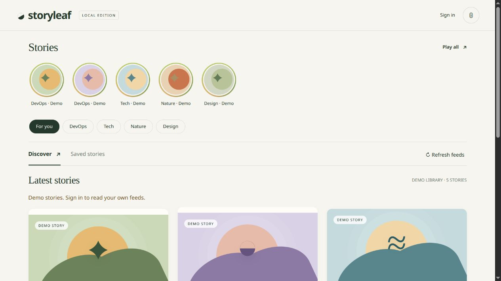
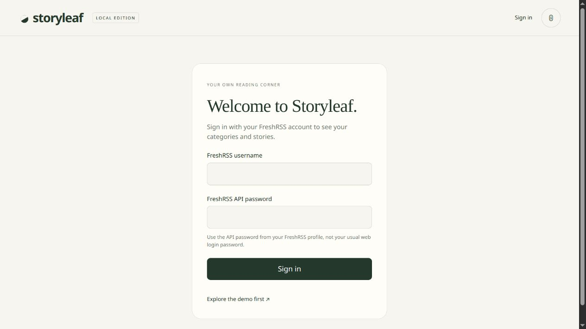
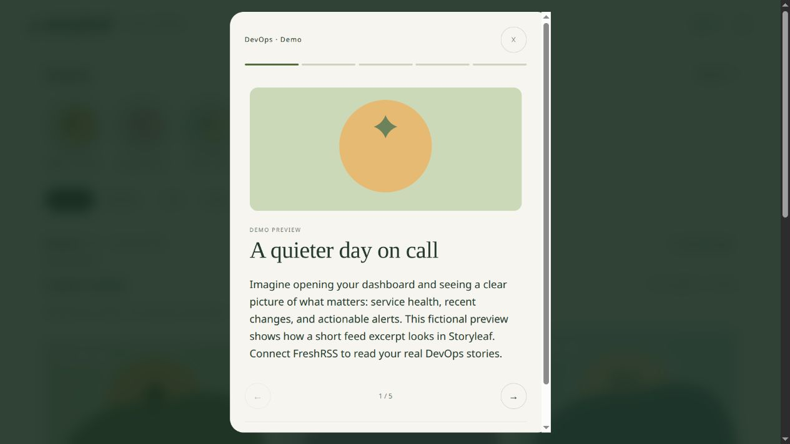

<p align="center">
  
</p>

# Storyleaf

**Your FreshRSS feeds, one story at a time.**

Storyleaf is a self-hosted, mobile-friendly FreshRSS reader. Pick a category, explore its ten newest articles in a row of story circles, and swipe through images, headlines, and short excerpts. Everyone in your household can use the same address and sign in to their own FreshRSS account.



*Screenshots use the built-in fictional demo. Your signed-in library comes from your own feeds.*

## Features

- Story circles with viewed/unviewed indicators and one-tap category selection.
- Swipe, button, and keyboard navigation through up to ten recent articles.
- Feed images, readable previews, and links to the original articles.
- Individual FreshRSS accounts with separate categories, saved stories, and preferences.
- Persistent sessions for up to 30 days; bookmarks sync across devices using the same account.
- iPhone and Android home-screen icons.
- Docker, Podman Compose, and single-node k3s deployment options.
- A demo you can explore without signing in.

<table>
  <tr>
    <td width="50%"></td>
    <td width="50%"></td>
  </tr>
  <tr>
    <td align="center">Each person signs in with their own account.</td>
    <td align="center">Read a preview, save it, or open the original.</td>
  </tr>
</table>

## Before you install

You need:

- An existing [FreshRSS](https://freshrss.org/) server reachable from Storyleaf.
- API access enabled in FreshRSS.
- Docker Compose, Podman Compose, or an existing k3s installation. Native preview only needs Python 3.12 or later.
- **HTTPS for normal signed-in use.** Session cookies are Secure by default. The app itself listens on HTTP behind your reverse proxy.

Storyleaf does not create FreshRSS users or manage subscriptions. Add feeds and organize categories in FreshRSS.

### Prepare each FreshRSS account

1. As a FreshRSS administrator, enable **Allow API access** under **Administration → Authentication**.
2. Each person signs in to FreshRSS and opens **Settings → Profile → External access via API**.
3. Set an **API password**, save it, and note the exact Google Reader-compatible API address shown there.

Each person signs in to Storyleaf using their **FreshRSS username and API password**. The API password is separate from the normal FreshRSS web-login password. Changing the web-login password does not set the API password.

## 1. Download and configure

```sh
git clone https://github.com/aebyss/StoryLeaf.git
cd StoryLeaf
cp .env.example .env
nano .env
```

Set your shared FreshRSS server addresses, for example:

```ini
FRESHRSS_URL=https://rss.example.com
FRESHRSS_API_URL=https://rss.example.com/api/greader.php
APP_PORT=8088
```

Use the **exact API address** displayed in your FreshRSS profile; some installations use a different path. A private LAN address is also supported when Storyleaf can reach it.

Do not put individual usernames or API passwords in `.env`. Each user enters those in Storyleaf's login form. Keep `.env` local; it is excluded from Git.

Choose one of the installation methods below.

## 2A. Docker or Podman Compose

From the project directory:

```sh
# Docker
docker compose up -d --build

# Or Podman
podman-compose up -d --build
```

The app listens on the host's port `8088`, unless you changed `APP_PORT`. Put your HTTPS reverse proxy in front of it. For a proxy running directly on the same host, the upstream is:

```text
http://127.0.0.1:8088
```

If your proxy runs in a container, use a reachable host address or attach it to the app's container network and use `http://storyleaf:8080`; `localhost` inside the proxy container is not the app container.

Open the HTTPS hostname you configured and sign in. Direct HTTP may show the login page, but Secure session cookies require HTTPS to retain the login.

Compose creates the `storyleaf-data` volume and stores sessions and per-account preferences in `/data/sessions.sqlite`. Keep this volume when upgrading.

## 2B. k3s on your Raspberry Pi / server

Run on the k3s node where the app should run. This method requires Podman, kubectl access to the cluster, sudo access to k3s, and a default StorageClass.

```sh
bash k8s/deploy.sh
```

The script builds with Podman, imports the image into k3s containerd, creates the namespace and environment Secret, and deploys the app. It pins the pod to the node containing the imported image. No container registry is required.

If the k3s node name differs from `hostname -s`:

```sh
kubectl get nodes
K3S_NODE=YOUR_NODE_NAME bash k8s/deploy.sh
```

Run this on that node itself. Keep a single replica for this local-image, SQLite deployment.

Add the HTTPS route using your existing Traefik installation:

```sh
TLS_HOST=storyleaf.example.com bash k8s/enable-tls.sh
```

Replace the example hostname locally. Make it resolve to Traefik's address on your devices. The script enables TLS routing but **does not obtain a trusted certificate**. Traefik must already have a matching certificate, or you must supply one.

If you have certificate files, import them into the `storyleaf` namespace:

```sh
sudo k3s kubectl -n storyleaf create secret tls storyleaf-tls \
  --cert=/path/to/fullchain.pem \
  --key=/path/to/privkey.pem \
  --dry-run=client -o yaml | kubectl apply -f -

TLS_HOST=storyleaf.example.com TLS_SECRET_NAME=storyleaf-tls \
  bash k8s/enable-tls.sh
```

Open your configured **HTTPS URL** and sign in. The HTTP NodePort `30088` remains available for connectivity checks, but authenticated use requires HTTPS.

Check the deployment:

```sh
kubectl -n storyleaf get pods,pvc,svc,ingress
kubectl -n storyleaf logs deployment/storyleaf
```

The deployment creates a 1 GiB PVC named `storyleaf-data` for sessions and bookmarks. The pod should become `1/1 Running`. See [the k3s guide](k8s/README.md) for TLS details, image imports, and troubleshooting.

## Try locally without containers

```sh
COOKIE_SECURE=false python3 server.py
```

Open `http://localhost:8080` and choose **Explore the demo first**, or sign in to your configured FreshRSS server. The server reads environment variables directly; native Python does **not** automatically load `.env`. To point it at a different FreshRSS server:

```sh
FRESHRSS_API_URL=https://rss.example.com/api/greader.php \
  COOKIE_SECURE=false python3 server.py
```

This HTTP option is for local development. Use HTTPS and Secure cookies for your deployed installation. Native preview stores account data in `data/sessions.sqlite` by default; use `SESSION_DB` to choose a different location.

## Add it to your phone

Open your HTTPS address on the phone:

- **iPhone / iPad:** Safari → Share → Add to Home Screen. Enable Open as Web App if offered.
- **Android:** Chrome → menu → Add to Home screen / Install.

For a LAN-only installation, the phone must use your home network or a suitable private VPN. Clearing browser data or reinstalling a shortcut may require signing in again.

## Update

Keep your existing `.env` and persistent storage.

```sh
git pull

# Docker
docker compose up -d --build

# Or Podman
podman-compose up -d --build

# Or k3s, on the node containing the app image
bash k8s/deploy.sh
```

Run only the command for your installation. Regular k3s app updates preserve the separate Ingress and TLS Secret. When reapplying TLS, the script can reuse the existing Ingress hostname and certificate Secret:

```sh
bash k8s/enable-tls.sh
```

Older shared-login settings (`FRESHRSS_USER`, `FRESHRSS_API_PASSWORD`, `APP_USER`, and `APP_PASSWORD`) are ignored and may be removed from `.env`. Legacy browser-only bookmarks are not automatically assigned to an account; the old browser cache is left untouched for manual recovery.

## Data and privacy

- Each feed request uses the signed-in person's FreshRSS token. Unsigned-in visitors can explore only fictional demo content.
- API passwords are used for login and are not saved in the database. The database stores upstream authentication tokens, hashed Storyleaf session tokens, and per-account preferences.
- Sessions last up to 30 days and survive restarts when storage is persisted. Logout revokes that device's session. FreshRSS access failures can require signing in again sooner.
- Cookies are HttpOnly, Secure, and SameSite=Strict. Account changes clear displayed content and notify other tabs to refresh authentication.
- The SQLite database is permission-restricted, **not encrypted**. Protect its volume and backups; server administrators can access its contents.
- Back up the data volume/PVC. Deleting it removes sessions and saved preferences. Keep one app replica for this household deployment.
- Feed images load directly from their source hosts. No app credentials are sent with those cross-site requests.

## What the previews contain

Storyleaf uses the text and images already supplied by FreshRSS. It strips HTML and shortens text at a word boundary; a preview is **not a generated summary**. Missing or broken feed images use decorative artwork.

The app does not scrape publishers' pages, change FreshRSS read/unread or starred state, provide offline article reading, or run background synchronization. A live connection is required.

## Troubleshooting

| Problem | What to check |
| --- | --- |
| Login fails | Use that user's API password, not the normal FreshRSS password. Confirm API access is enabled. |
| Login immediately returns to the form | Open the HTTPS URL. Secure cookies do not work for normal plain-HTTP use. |
| No categories or articles | Confirm the account has subscriptions and the configured API URL is correct. |
| Feed pictures are missing | The feed may contain no images; decorative artwork is the expected fallback. |
| Cannot find `.env` after cloning | Create it with `cp .env.example .env`; it is deliberately not stored in Git. |
| k3s pod stays Pending | Check `kubectl -n storyleaf get pvc` and the node label/image import. A default StorageClass is required. |
| `ErrImageNeverPull` | Run the deployment script on the node where the pod is scheduled so its containerd has the image. |
| Self-signed/default certificate | Configure a trusted certificate covering your hostname and select its TLS Secret. |
| HTTPS works with `curl --resolve`, but not by hostname | Check client DNS and any router DNS-rebind protection. |

## Development checks

```sh
python3 -m unittest discover -s tests -v
node --check public/app.js
```

The automated tests cover account isolation, preferences, session persistence/expiry, cookie properties, logout, origin checks, login throttling, and feed content handling. Browser checks use mock FreshRSS accounts; verify your own server and cluster after deployment.

[FreshRSS API documentation](https://freshrss.github.io/FreshRSS/en/developers/06_GoogleReader_API.html) · [k3s setup guide](k8s/README.md)
